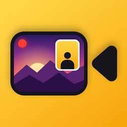
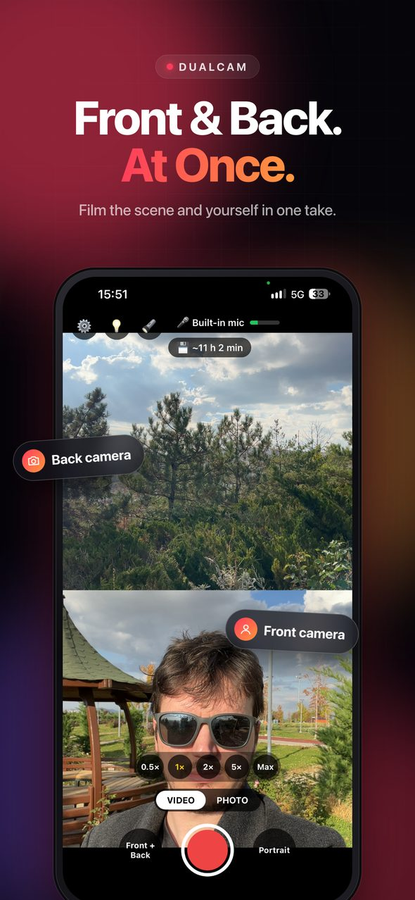
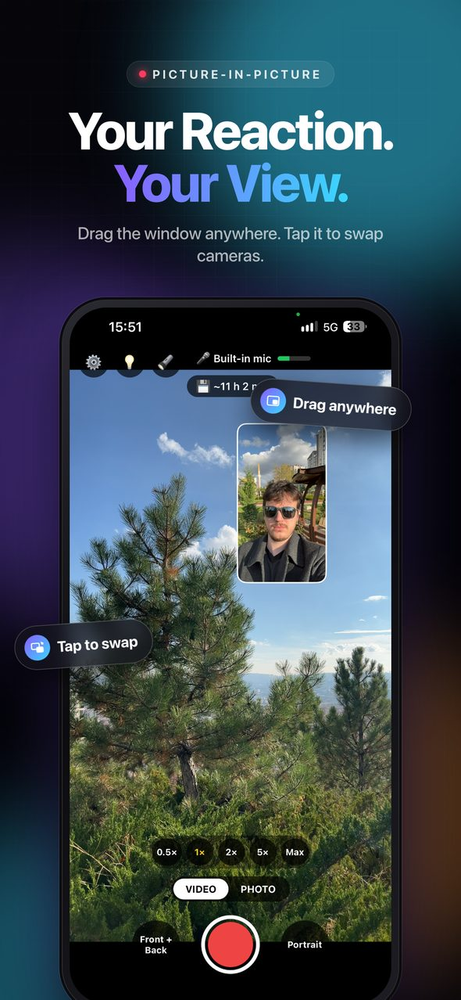
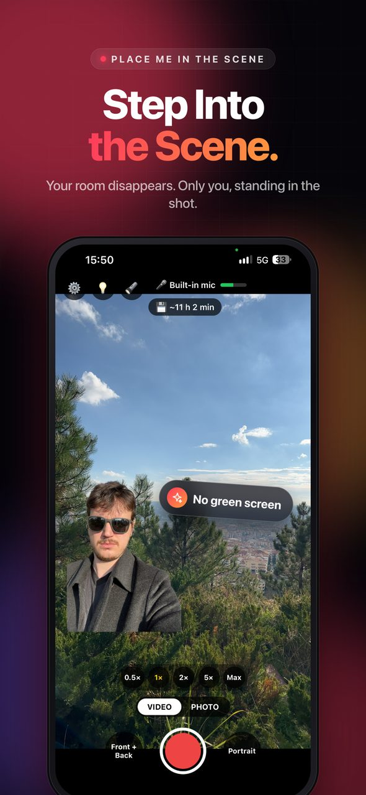
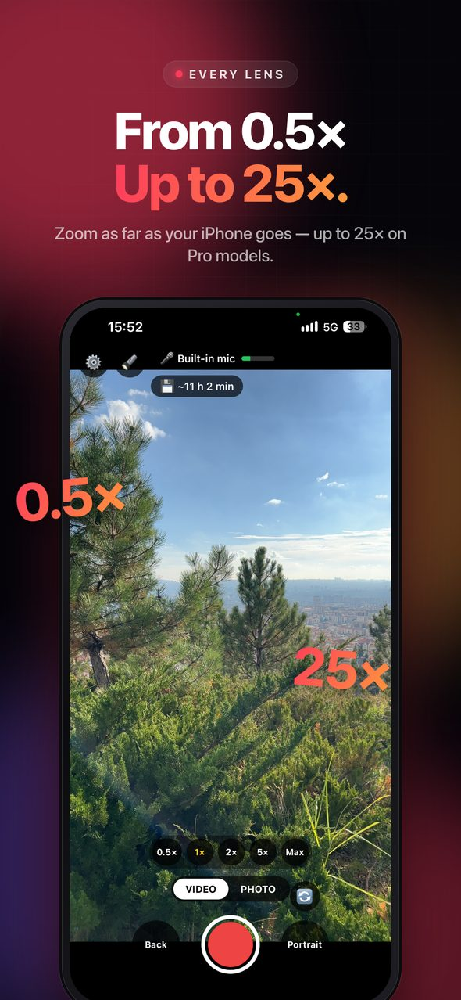
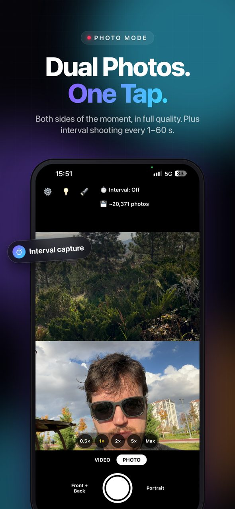
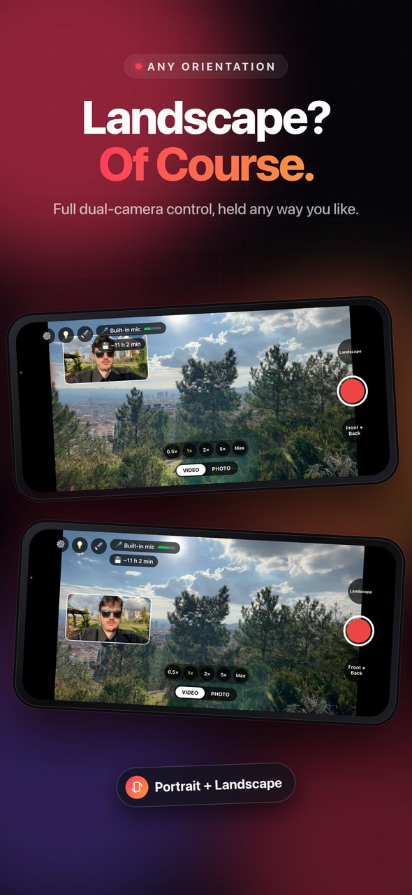
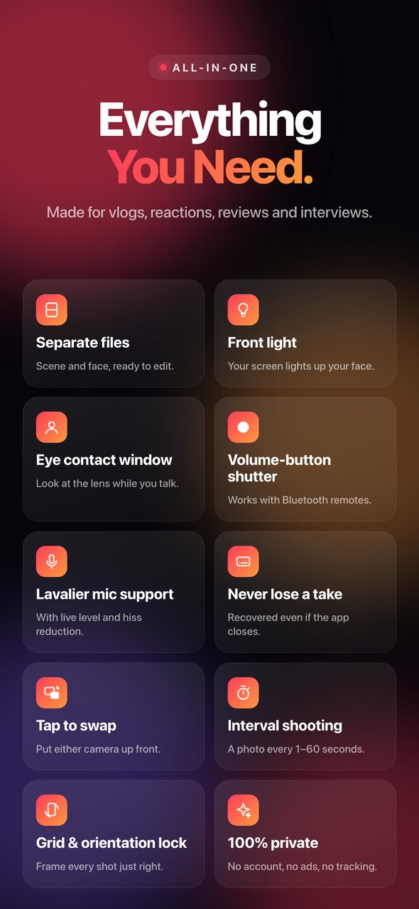

# Dual Camera: Vlog Front & Back

**Record with your iPhone's front and back cameras at the same time.**
Film the scene and your face in one take: for vlogs, reactions, reviews and interviews.

<a href="https://apps.apple.com/app/id6818864421"><b>Download on the App Store</b></a>
&nbsp;·&nbsp; Free &nbsp;·&nbsp; No ads &nbsp;·&nbsp; No account &nbsp;·&nbsp; No tracking

 

## What it does

| | |
|---|---|
| 🎥 **Both cameras, one take** | Picture-in-picture, split screen, or cut yourself out and stand inside the scene (no green screen). |
| 🎞️ **One file or two** | A single combined video, or the scene and your face as separate files for editing. |
| 📸 **Dual photos** | Both sides of the moment in full quality, plus interval shooting every 1–60 s. |
| 🔍 **Every lens** | 0.5× ultra wide up to your iPhone's limit (25× on Pro models), pinch or quick buttons. |
| 🔄 **Any orientation** | Landscape or portrait; controls follow the hand you hold the phone with. |
| 🎙️ **Real audio** | Lavalier and USB mics, live level meter, optional hiss reduction. |
| 👀 **Eye contact window** | A small copy of the preview sits next to the lens, so you look at the camera while you talk. |
| 💡 **Front light, volume-button shutter** | Light up your face with the screen; start and stop with the volume buttons or a Bluetooth remote. |
| 🛟 **Never lose a take** | Pause and resume, photos mid-recording, and recordings are recovered even if the app closes. |
| 🌍 **English and Turkish** | Follows the phone's language, or pick one in Settings. |

## Requirements

An iPhone that can run two cameras at once (iPhone XS / XR or newer) with iOS 16.4 or later.

## How it's built

- **Expo / React Native** for the interface (`src/`).
- **A native Swift camera module** (`modules/dual-camera/ios`) on `AVCaptureMultiCamSession`: both cameras, formats that fit the hardware budget, recording, photo capture, picture-in-picture compositing and person cut-out.
- The cameras start while the app is still loading, so the preview is there the moment the screen appears.

## License

© 2026 Burak Arslan. **All rights reserved.** The code is public so you can read it and learn from it. It may not be copied, republished, or released on the App Store or any other store. See [LICENSE](LICENSE).

---

<b>Türkçe</b>

**Dual Camera**, iPhone'un ön ve arka kamerasıyla aynı anda video ve fotoğraf çeker. Sahneyi ve yüzünü tek çekimde kaydedersin: vlog, tepki videosu, ürün incelemesi, röportaj.

[App Store'dan ücretsiz indir](https://apps.apple.com/app/id6818864421). Reklam yok, hesap yok, takip yok.

Kod incelemek ve öğrenmek için açıktır. Kopyalanamaz, yeniden yayımlanamaz, App Store'a ya da başka bir mağazaya konamaz. Tüm hakları saklıdır.

